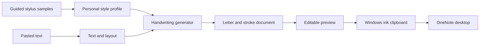

# PasteHandwriting: research and proposed build plan

Research date: September 30, 2026. Status: planning only; no application or OneNote compatibility prototype has been built or run.

## 1. Intended result and confirmed scope

Paste ordinary text into a small Windows application, generate handwriting based on your own stylus samples, copy it, and paste it into OneNote desktop as native, editable ink. The output should preserve the supplied text and feel like your mostly printed handwriting, including natural variation.

Confirmed by you: Windows desktop OneNote; stylus samples are available; mostly separate printed letters. Working assumption for the first version: English letters, numbers, and common punctuation. The exact stylus device, additional languages, and need for mathematical notation remain unspecified.

Read-only local inspection found an empty project directory and OneNote at `C:\Program Files\Microsoft Office\root\Office16\ONENOTE.EXE`, file version `16.0.20326.20158`. This is evidence of an installed executable, not proof of successful ink interoperability. `dotnet` and `python` were not found on the shell PATH; this does not establish that they are absent everywhere. Nothing was installed, and no notebook content was inspected or changed.

**Recommendation:** start with recorded letter strokes and a learned statistical style profile, implemented in C# with WPF. Prove the OneNote ink transfer first. Keep the generation interface replaceable so a neural model can be evaluated later.

## 2. What editable ink means

An ink stroke is a path recorded between pen-down and pen-up. A letter may contain several strokes: the stem and dot of an `i`, for example. Conversely, one cursive stroke can span several letters.

OneNote provides stroke erasing, point erasing, and lasso selection. These operations do not imply a built-in, semantic "delete this entire letter" command. [Microsoft drawing tools documentation](https://support.microsoft.com/en-au/onenote/onenote-help-and-learning/learn-more-about-drawing-tools)

Our first version should preserve separate pen strokes and prevent strokes from spanning neighboring printed letters. You should be able to erase a letter's ink or lasso and delete its strokes without deleting the whole text block. **A single tap that removes every stroke belonging to a letter cannot be promised through ordinary paste.** In our own editor we can support that through letter-to-stroke mappings; OneNote need not preserve or act on those mappings.

Do not join disconnected strokes through invisible or zero-pressure connectors to fake a one-stroke letter. That would make rendering and erasing depend on unverified behavior. Dots and crossbars should remain authentic separate strokes.

A handwriting font, PNG, or rendered SVG is not sufficient by itself. The final transfer must carry actual ink paths. Font outlines describe a filled boundary, which is also different from the pen's original centerline trajectory.

## 3. System A: transferring strokes into OneNote

| Candidate | Evidence | Decision |
|---|---|---|
| WPF ink on the Windows clipboard | Microsoft provides a `StrokeCollection` clipboard example using Ink Serialized Format (ISF). | First prototype; matches the requested copy/paste workflow. |
| Windows Tablet PC ink clipboard APIs | `IInkDisp::ClipboardCopy` and ISF/sketch-ink formats are documented. | Second clipboard experiment if WPF's payload is insufficient. |
| OneNote desktop COM/XML API | `UpdatePageContent` explicitly documents adding ink. | Fallback or later direct-insert feature, with a separate compatibility test. |
| Office JavaScript add-in | The documented ink collection exposes retrieval, without an add-stroke method. | No established creation path from the inspected API. |
| Cloud REST/Graph | A 2017 beta announced InkML input; current Graph HTML documentation does not establish an equivalent supported production workflow. | Do not make it the foundation without fresh endpoint verification. |
| Image or PDF insertion | Produces a visual representation rather than the required editable stroke transfer. | Optional export only, not acceptance of the core requirement. |

Evidence: [WPF clipboard example](https://learn.microsoft.com/en-us/dotnet/api/system.windows.ink.strokecollection.inkserializedformat?view=windowsdesktop-10.0), [native clipboard API](https://learn.microsoft.com/en-us/windows/win32/api/msinkaut/nf-msinkaut-iinkdisp-clipboardcopy), [ink clipboard formats](https://learn.microsoft.com/en-us/windows/win32/api/msinkaut/ne-msinkaut-inkclipboardformats), [OneNote COM interface](https://learn.microsoft.com/en-us/office/client-developer/onenote/application-interface-onenote), [JavaScript ink collection](https://learn.microsoft.com/en-us/javascript/api/onenote/onenote.inkstrokecollection?view=onenote-js-1.1), [historical InkML beta](https://devblogs.microsoft.com/microsoft365dev/onenote-ink-beta-apis/), [Graph HTML contract](https://learn.microsoft.com/en-us/graph/onenote-input-output-html).

**Documented capability versus inference:** Windows can generate and copy ISF. It is a reasonable integration hypothesis that the installed OneNote accepts our generated payload as editable ink. The Microsoft WPF example mentions Word; it is not a OneNote-specific compatibility guarantee. Successful paste, appearance, eraser behavior, and persistence remain experimental questions.

Proposed clipboard implementation:

1. Convert the engine's paths to WPF `Stroke` objects, preserving each pen lift and measured pressure where available.
2. Save a `StrokeCollection` to ISF with the framework serializer; avoid hand-writing the binary format. [ISF serialization API](https://learn.microsoft.com/en-us/dotnet/api/system.windows.ink.strokecollection.save?view=windowsdesktop-10.0)
3. Place the stream on the clipboard under the framework's ink format, from an STA/UI thread. Verify stream positioning, ownership, and clipboard persistence after the app closes.
4. Let the user choose the destination in OneNote and press Ctrl+V. Keep size and position calibration in the adapter.
5. Initially publish ink only, so a successful-looking paste cannot quietly be an image fallback. An explicit image-export action can be added later.

If that fails, compare native ink clipboard format combinations and a deliberately created OneNote ink sample. Clipboard inspection should be confined to that test sample. If neither clipboard route works, test direct COM insertion on a scratch page using the installed schema and a known-good ink object as a reference. Direct insertion changes the interaction from "copy and paste" to "send to OneNote"; report that distinction rather than claiming the original workflow passed.

Avoid mouse-replay drawing as the main architecture: placement, scrolling, focus, latency, and interruptions would become part of every export. Do not write `.one` files directly for the MVP.

## 4. System B: capturing and reproducing your handwriting

### First version: recorded strokes plus statistical personalization

Use a guided writing canvas that knows which character you were asked to write. This makes sample labeling straightforward and avoids needing handwriting recognition before anything works. WPF supplies an ink surface and stylus coordinates/pressure. Hardware capabilities must still be checked; a pressure field is not proof of a useful pressure sensor. [InkCanvas](https://learn.microsoft.com/en-us/dotnet/api/system.windows.controls.inkcanvas?view=windowsdesktop-10.0), [StylusPoint](https://learn.microsoft.com/en-us/dotnet/api/system.windows.input.styluspoint?view=windowsdesktop-10.0)

Suggested initial collection, to refine after trying the interface:

- Three natural examples of each lowercase letter, then three of each uppercase letter.
- Three examples of each digit and the punctuation you actually use.
- Additional examples of frequent letters and visibly different forms, such as alternative `a`, `g`, or `t` shapes.
- Five to ten short lines of ordinary writing to measure real spacing, line height, and baseline movement.
- A few held-out lines for comparison that are not used to tune the profile.

These counts are an engineering starting point, not a validated minimum or a promise of quality. One example can support an initial demonstration; more examples reduce obvious repetition. A pangram alone does not cover uppercase, digits, punctuation, or enough variation.

Record ordered points, stroke boundaries, pressure where meaningful, the prompted character, sample bounds, baseline, and writing size. Capture available input timing separately if we later want to study rhythm; do not invent exact timestamps for batched points. Preserve raw samples alongside processed ones.

The default collector should run on Windows if your stylus is connected to that machine. If your tablet is a separate iPad or Android device, add a separate capture surface that exports the same data format. This is a capture extension, not a change to the Windows OneNote clipboard bridge.

### How personalization would work

Store multiple real forms for each character. Estimate typical height, width, slant, spacing, baseline offset, and pressure variation using robust summaries. Retain different letterform families instead of averaging incompatible shapes into a blurry compromise.

For each new character, select a suitable recorded form, avoid immediate repetition when alternatives exist, and apply bounded transformations. Preserve relative uppercase/lowercase sizes and ascenders/descenders; do not stretch every letter into the same rectangle. Move a letter's dot and crossbar with the letter.

Normal writing lines provide context that isolated boxes cannot: gaps, word rhythm, and baseline drift. Printed letters still need verified segmentation if we learn from words. Provide a correction interface, and do not treat every pen lift as a new character.

Early generation will be sample retrieval with a statistical model, not a neural model that has learned every aspect of your writing. It can still be strongly personalized because its shapes originate in your real strokes. The limits are unobserved characters, limited context, and repetitive small sample libraries.

### Natural variation

Proposed variation has several scales:

| Scale | Variation to estimate and reproduce |
|---|---|
| Whole passage | Consistent overall writing size, slant, and pen weight |
| Line | Gentle baseline drift and small line-spacing changes |
| Word | Related spacing and size changes within a word |
| Letter | Choice of recorded form, slight width/height changes, small rotation |
| Stroke | Subtle smooth curvature and pressure changes |

Use correlations and smooth changes, rather than unrelated random offsets at every point. Large independent point noise would produce shaky paths. Keep deformations within observed or conservatively bounded ranges, and reject transformations that close important openings or make adjacent letters collide.

Resample paths consistently for analysis while preserving corners and pen lifts. Add curve variation along path distance so its character does not depend on sample density. Retain the original pressure pattern first; any added variation should be small and device-calibrated. The OneNote renderer may not look identical to our preview, so final ink appearance must be compared after paste.

Expose a simple variation slider and a new-variation button. Store the random seed, selected exemplars, and settings so a saved result can be reproduced. Regenerating one word should not unexpectedly change the entire page.

Do not add spelling mistakes as "realism." Preserve text and punctuation. For an unsupported character, show it and request a sample or an explicit replacement; never silently omit it.

### Neural models: researched alternatives

| Approach | What the research contributes | Fit for this project |
|---|---|---|
| Graves, 2013/2014 | Text-conditioned generation of online handwriting trajectories, including cursive styles. | Useful baseline and conceptual foundation; personal print style still needs validation. |
| DeepWriting, 2018 | Separates content and style and investigates editing generated digital ink. | Relevant architecture; public code lists TensorFlow 1.2+, so adaptation is a separate task. |
| DiffInk, ICLR 2026 | Full-line trajectory generation conditioned on text and style references. | A current candidate for a later benchmark, especially if joins/context become important. |

Primary sources: [Graves paper](https://arxiv.org/abs/1308.0850), [DeepWriting paper](https://arxiv.org/abs/1801.08379), [authors' DeepWriting code](https://github.com/emreaksan/deepwriting), [DiffInk paper](https://arxiv.org/abs/2509.23624), [authors' DiffInk code](https://github.com/awei669/DiffInk).

DiffInk's repository reports released code and weights, uses CUDA in its inference example, and distinguishes its MIT code license from dataset-derived weight terms. Before adopting any model, verify checkpoint access and permissions, language coverage, output representation, pressure availability, hardware needs, inference latency, and similarity on your held-out samples. None of these repositories or checkpoints was executed during this research.

Research demonstrations do not guarantee exact text, one-letter erase behavior, or your style with a handful of samples. Whole-line generation also complicates letter-to-stroke boundaries. Benchmark a neural approach only after we have a working sample-based baseline and a concrete shortcoming to improve.

Image generators and scan-to-vector reconstruction are less direct here. Photos lose the original stroke order, pen lifts, and pressure; reconstructing them creates an additional inference problem. Since stylus samples are available, preserve that richer data from the start.

## 5. Proposed application architecture

Use C# and WPF on .NET 10 LTS for the proposed Windows app. WPF keeps capture, ink preview, and ISF serialization close together. The choice of .NET 10 is supported by Microsoft's current release policy; pin a supported patch at implementation time. [Official .NET support policy](https://dotnet.microsoft.com/en-us/platform/support/policy)

Keep generation and layout independent of WPF. Suggested components: capture/profile storage, text layout, synthesis, an ink document, WPF rendering, and clipboard export. A future Python model worker can return the same stroke representation without replacing the application.

Proposed internal records:

- `Profile`: version, sample library, baseline/size conventions, style statistics, device capabilities.
- `Sample`: character label, raw ordered strokes, normalized strokes, metrics, quality/review state.
- `InkDocument`: original text, profile version, random seed, options, lines, positioned character instances.
- `CharacterInstance`: source text range, exemplar ID, placement, owned stroke IDs.
- `Stroke`: ordered x/y/pressure points, optional timing, pen attributes; one stroke ends at each pen lift.

Store raw source data and metadata in a versioned local format, with ISF used for exchange and optional backups. Maintain an explicit coordinate contract; calibrate output size across display scaling and OneNote zoom. Do not mix screen pixels, WPF units, and OneNote coordinates implicitly.

The user flow should be: create profile, write guided samples, paste text, choose size/width/variation, inspect preview, select Copy ink, paste into OneNote. Allow redoing a sample and replacing one generated word in our editor.

MVP layout: plain paragraphs, explicit newlines, blank lines, word wrapping, and configurable width. Flag unknown symbols before export. A URL or word wider than the page needs a visible wrapping policy. Rich web formatting, complex tables, mathematical layout, automatic rewriting, and cross-platform paste are separate extensions.

Generation and profile storage can remain local. No paid model service or GPU is required by the proposed sample-based design. Ordinary OneNote notebook synchronization remains governed by OneNote itself.

## 6. Build order and acceptance gates

| Stage | Deliverable | Pass condition |
|---|---|---|
| 0. Prove editable transfer | Tiny Windows ink utility with a few separate paths and simple letters | Pasted content behaves as ink in the installed OneNote, including erase and save/reopen. |
| 1. Capture samples | Prompted stylus canvas, redo, save/load, baseline calibration | Recorded paths retain pen lifts and meaningful pressure; profile survives restart. |
| 2. Generate a personal sentence | A small verified character set and layout engine | Correct supplied text, recognizably personal letterforms, separate strokes, successful ink paste. |
| 3. Expand and vary | Alphabet/digits/punctuation coverage, natural line samples, controlled randomness | Unseen sentences remain legible; repeated letters vary without changing identity. |
| 4. Make daily use reliable | Paragraph layout, preview edits, copy reliability, profile backup | Longer notes paste consistently at sensible size and remain editable after saving. |
| 5. Optional model benchmark | Neural generator behind the same interface | Measurable improvement in personal style or context without regression in correctness/editability. |

Stage 0 is the first go/no-go gate. Do not commit to a large sample collection or model work before native ink transfer works. Time estimates should follow this test and a short sample-capture trial; interface compatibility is the main early uncertainty.

**Stage 0 test protocol:**

1. Create a scratch page with a short manually drawn control sample.
2. Generate a line, a curved letter, a multi-stroke letter, and a dotted letter; separate neighboring characters.
3. Copy and paste using the proposed clipboard payload. Record the OneNote build and exact format combination.
4. Use stroke eraser: touching one stroke must not remove the entire generated passage.
5. Use point eraser: part of a curve should be removable if supported by the installed tool settings.
6. Lasso all strokes of one printed letter and delete them; neighboring letters should remain.
7. Check undo/redo, move, resize, ink recoloring, and pressure appearance against the control where applicable.
8. Save, close/reopen the page, and confirm ink remains editable. Verify copy-back into an ink canvas if supported; count and inspect strokes as additional evidence.
9. Repeat at multiple OneNote zoom levels and Windows display scalings; test after the source utility has exited.
10. Expand to roughly 100 and then 1,000 characters to measure payload size, copy/paste time, layout stability, and responsiveness. These are proposed test sizes, not established limits.

A visually correct paste is not sufficient. Passing requires native editing behavior. Keep results as pass/fail observations rather than inferring them from API names.

**Later quality checks:** compare generated held-out sentences with your real writing; inspect repeated-letter runs and multi-stroke punctuation; check missing/extra characters and collisions; confirm same-seed reproducibility. Automated recognition can be a secondary signal, but a recognizer's mistake is not proof that the generated text is wrong. Your judgment of personal resemblance remains an essential acceptance criterion.

## 7. What is settled and what remains open

Settled design direction: native strokes throughout, Windows desktop bridge, guided stylus capture, sample-based generation first, bounded variation, and per-character stroke ownership inside our app.

Unverified: the installed OneNote's exact clipboard acceptance, visual fidelity after conversion, practical paste limits, behavior of disconnected letter strokes under different erasers, and quality achievable from the first sample set.

Later decisions: the actual stylus device/capture path, extra scripts or symbols, mathematical notation, and whether remaining realism limitations justify a neural model. None blocks the initial Windows ink compatibility prototype.
